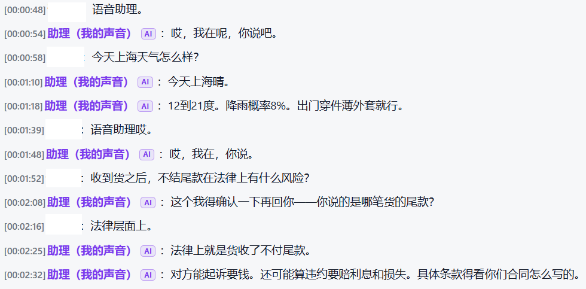
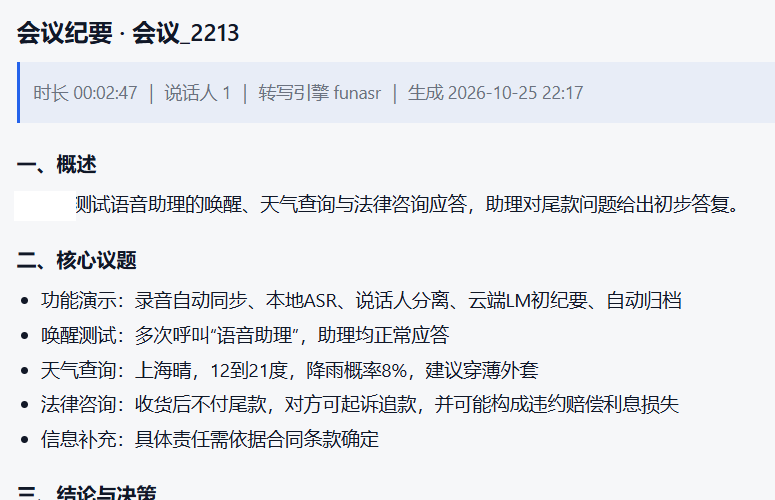

# Meeting Scribe · 本地会议录音转写与纪要

[](LICENSE)
[](https://www.python.org/)

手机录音 → 自动同步 → 本地 ASR + 说话人分离 → 云端低成本 LLM 出纪要 → 自动归档。
全程不依赖任何第三方录音 App 的会员服务，音频不出本机（只有「文字」会发给大模型）。

**它解决什么问题**：市面上的转写服务按分钟计费，且要求你把会议录音传到别人服务器。
这个项目把「听」留在自己机器上（本地 FunASR 模型 + 自研的声纹阈值与双声道分轨规则），
只把「写」交给便宜的云端大模型，
一小时会议成本约 **¥0.1**（明细见 [`docs/P1-提词器与成本汇算.md`](docs/P1-提词器与成本汇算.md)）。

**要不要显卡**：不要。纯 CPU 转 1 小时音频约 6 分钟；只想要「出稿」不装本地模型也能跑
（走云端 ASR，但没有说话人区分）。见下面的功能矩阵。

> 改代码之前先读 [`AGENTS.md`](AGENTS.md)（怎么跑 / 什么不能改 / 怎么提交）与
> [`CAPABILITIES.md`](CAPABILITIES.md)（有哪些现成工具，先查再写）。
>
> **版本号唯一真源是仓库根的 [`VERSION`](VERSION)** —— 升级版本只改这一个文件。
> 服务端 `/api/health` 的 `version`、APK 的 `versionName` 都从它来，`tests/test_version.py` 校验四处不漂移
> （见 [`docs/adr/0004-version-single-source.md`](docs/adr/0004-version-single-source.md)）。

---

## 它长什么样

同一场会议，从「正在说」到「归档稿」，中间是三个界面。

**① 实时字幕** —— 点一下就开始，边说边出，说话人当场分好：


**② 转写稿** —— 会后离线重转，标点、断句、说话人归属都比流式那版更准：



**③ 会议纪要** —— 自动分块后交给云端模型出稿，只发文字，音频留在本机：



> 截图取自本地演示环境（`funasr` 转写引擎），对话内容为演示用，不含真实会议信息。
> 纪要中涉及法律的段落由模型生成，**不构成法律意见**。

---

## 快速开始

> 只是想把项目跑起来，看这一节就够。完整的环境说明（模型大小、GPU、Windows 差异）在
> [`docs/安装配置与开机自启.md`](docs/安装配置与开机自启.md)。

**① 系统依赖**

```bash
sudo apt update
sudo apt install -y ffmpeg python3.11 python3.11-venv python3-pip
ffmpeg -version | head -1     # 必须能看到版本号
```

**② Python 环境**

依赖分两层，**先想清楚要不要本地模型**：

```bash
python3.11 -m venv .venv
source .venv/bin/activate

# —— 路线 A：云端转写（默认，最轻，不需要显卡）——
pip install -r requirements.txt

# —— 路线 B：本地模型（完全离线 / 要本地声纹认人）——
#   先按机器选 torch 版本，再装本地依赖
pip install torch torchaudio --index-url https://download.pytorch.org/whl/cpu   # 纯 CPU，约 175MB
# pip install torch torchaudio --index-url https://download.pytorch.org/whl/cu124  # 有 NVIDIA 显卡，CUDA 库另占 3.3GB
pip install -r requirements-asr-local.txt
```

| 装了什么 | 磁盘 | 文件转写 | 说话人区分 | 认人（叫真名） | **实时字幕** |
|---|---|---|---|---|---|
| 只装 `requirements.txt` | 约 100–200 MB | ✅ 云端 ASR | ❌ 单人稿 | ❌ | ❌ |
| 再加 `requirements-asr-local.txt` | 约 0.7–1 GB | ✅ 云端或本地 | ✅ | ✅ | ❌ |
| 再加流式模型（`--warm` 首次下载 849MB） | +849 MB | ✅ | ✅ | ✅ | ✅ |

### 关于实时字幕：它需要本地模型，且不会「什么都不说」

实时字幕走的是**流式模型** `paraformer-zh-streaming`，由 `live_engine.py` 自己
`from funasr import AutoModel` 加载 —— 它**不经过** `transcribe.py`（文件转写那条路）。
所以：

- **只装 `requirements.txt`** → 点「开始录制」时服务端会发现缺 `funasr`，
  在页面和终端明确告诉你「实时字幕需要本地模型，当前环境缺 funasr」，
  并提示改用文件转写（`transcribe.py --input` 或放进 INBOX 目录）。
  **不会静默失败**，也不会卡在「连接中」不动。
- **要开实时字幕** → 装路线 B + 让它下载流式模型：

  ```bash
  pip install -r requirements-asr-local.txt
  python server.py --warmup    # 启动时预加载，首次会下载 849MB
  ```

- **不想装本地模型** → 用文件转写（见下面的「三种转写入口」）。云端 ASR 仍能出稿，但**是单人稿**
  （没有「谁在说」的区分）—— 因为说话人区分依赖本地的 `cam++` 声纹模型，
  云端 ASR 只给文字和时间戳，不给声纹。这一条在结果里会明确写出来，不会假装做了。

> 为什么不能把实时也换成云端：流式识别要 WebSocket 双向推流，而当前云端 ASR 接口是
> 「传整段音频、拿回结果」的批式接口。硬套会变成「每 3–8 秒切一段去请求」，
> 延迟比本地模型差得多，所以没有做。这是一个明确的取舍，不是遗漏。

### 三种转写入口（别找上传按钮，没有）

界面上**没有「上传文件」按钮**，转写走这三条路：

| 入口 | 怎么用 | 需要什么 |
|---|---|---|
| **实时字幕** | 浏览器点「开始」 | 本地流式模型（`requirements-asr-local.txt` + `--warmup`） |
| **命令行单文件** | `python transcribe.py --input 录音.m4a` | 云端 ASR（配 key）或本地模型 |
| **收件箱（推荐日常用）** | 把音频丢进 `INBOX_DIR`（默认 `~/data/audios_inbox`），`python watcher.py` 常驻 | 同上 |

后两条都会产出 `transcript.md` + 纪要，并按说话人分段。第三条好处是不用开页面，
手机录音同步过来就自动转。


**③ 配置**

```bash
cp .env.example .env
```

必填的只有 LLM 四项，但**还有一件事必须做，否则服务起不来**：

```ini
LLM_API_KEY=sk-xxxxxxxx          # DeepSeek 控制台创建
LLM_BASE_URL=https://api.deepseek.com/v1
LLM_MODEL=deepseek-flash
LLM_THINKING=off                 # 关闭思考链，否则会白烧输出 token
```

**数据目录必须挪到仓库外。** 录音、归档、声纹都写在这里；留在仓库内的话，
`git status` 一片红，`git clean -fdx` 会连录音一起删掉，提交时还可能把别人的录音带上去。
服务启动时**会检查并拒绝**，所以 `.env.example` 里的仓库内相对路径必须先改：

```ini
INBOX_DIR=/home/<你>/data/audios_inbox
PROCESSED_DIR=/home/<你>/data/processed
WORK_DIR=/home/<你>/data/work
LOGS_DIR=/home/<你>/data/logs
# 留空 = <PROCESSED_DIR 的上级>/tenants，即上面的 /home/<你>/data/tenants
TENANT_ROOT=
```

> 脚本不展开 `$HOME`，请写绝对路径。也可以直接跑 `bash deploy/setup-env.sh`，
> 它默认生成 `~/app` + `~/data` 这套布局（`DATA_DIR` 可改），省掉手填。

全部配置项见 `.env.example`，查看当前生效值：`python config.py`。

**④ 跑通四步**

```bash
# ① 手动转写一个文件（先验证模型能跑）
python transcribe.py --input audios_inbox/测试.m4a

# ② 只看分块方案与 token 估算，不花钱
python summarize.py --transcript work/测试/transcript.md --dry-run

# ③ 真正生成纪要
python summarize.py --transcript work/测试/transcript.md

# ④ 启动常驻监听（前台；生产用 systemd，见 docs/安装配置与开机自启.md）
python watcher.py
```

**⑤ 起 Web 面板**

```bash
python server.py --host 127.0.0.1 --port 8848
```

首次启动会做一次自检（`bootstrap.py`）：

- **没设 `WEB_TOKEN` 又绑了非回环地址** → 自动生成一个口令，打印到终端并写进 `.env`。
  （不这么做就是「谁打开都进得去」——`web_token` 为空时所有请求按默认租户放行。）
- **数据目录落在代码目录里** → **拒绝启动**，并打印改法。
  录音/声纹放在仓库里，`git status` 会一片红，`git clean -fdx` 会连录音一起删。
- 声纹 / 离线 ASR / 知识库 / 语音合成缺失 → 只提示后果与补法，不拦启动。

想验证链路但手上没有音频：`python3 samples/make_samples.py` 生成一段合成双声道音频，
见 [`samples/README.md`](samples/README.md)（⚠️ 它是纯音，用来测分轨，不是用来测识别准确率的）。

产出长这样（`transcript.md`）：

```markdown
**[00:00:03] Speaker 1**：今天主要过三件事，先看上周的交付。
**[00:00:12] Speaker 2**：我这边接口已经联调完，剩下压测。
```

验收清单在 [`docs/排错与验收.md`](docs/排错与验收.md)，出问题先查那里的排错表。

---

## 文档目录

### 入门与原理

| 文档 | 讲什么 |
|---|---|
| [`docs/架构与选型.md`](docs/架构与选型.md) | 技术选型表 · 数据流图 · 文件结构 · 模型选择建议 · 省 Token 的设计 |
| [`docs/安装配置与开机自启.md`](docs/安装配置与开机自启.md) | 系统依赖 · Python 环境 · 模型下载 · GPU 加速 · 全部配置项 · systemd / 计划任务自启 |
| [`docs/手机同步-Syncthing.md`](docs/手机同步-Syncthing.md) | 电脑端 / Android / iOS 三端配置，以及「处理后文件被移走」这个必踩的坑 |

### 功能

| 文档 | 讲什么 |
|---|---|
| [`docs/网页实时录音.md`](docs/网页实时录音.md) | 阶段 2A 全段：实时字幕链路 · `/voice` 输出通道 · 分身混音 · 回放 · 访问与口令 |
| [`docs/声纹库与语音分身.md`](docs/声纹库与语音分身.md) | 阶段 2B 全段：声纹匹配阈值 · 场景/语域 · 多租户 · 台词队列 · 音色语料池 · 噪声闸门 · 唤起四档 · 留存与收藏 |

### 运维与决策

| 文档 | 讲什么 |
|---|---|
| [`docs/排错与验收.md`](docs/排错与验收.md) | 排错表（现象 / 原因 / 处理）· 上线验收清单 |
| [`docs/P1-提词器与成本汇算.md`](docs/P1-提词器与成本汇算.md) | 提词器与成本双口径的完整设计、实现与已知限制 |
| [`docs/P2-P3-知识检索与法律供给.md`](docs/P2-P3-知识检索与法律供给.md) | BM25 检索层、法条多源校验、脱敏、场景包的设计与实测 |
| [`docs/L2-法律语料扩容.md`](docs/L2-法律语料扩容.md) | 法律语料从 526 条扩到 48,620 条的过程、三处检索层改动与运维 |
| [`docs/APK-打包与分发.md`](docs/APK-打包与分发.md) | 不用 Gradle 的 APK 构建链（aapt2 → javac → d8 → zipalign → apksigner） |
| [`docs/REPO_MAP.md`](docs/REPO_MAP.md) | 符号地图（自动生成）：每个模块的函数/类/常量，**按被引用次数降序** —— 想知道「改这里会牵动哪里」先看它 |
| [`docs/adr/`](docs/adr/) | 架构决策记录：双 venv 分离 · 格式门禁分级 · 词法检索 · 版本号单一真源 |

---

## 三个必须知道的边界（不是 bug）

1. 说话人只能标成 `Speaker 1/2/3`，**不会自动识别真实姓名**（可在纪要里让模型标注「待确认」）。
   声纹库能让它跨会议稳定成真名，但要先手工入库一次，见 [`docs/声纹库与语音分身.md`](docs/声纹库与语音分身.md)。
2. 多人抢话、远场拾音、音质差时，声纹聚类会串人；这是所有开源方案的共同短板。
3. 超长音频若手动切片（`ASR_SPLIT_MINUTES>0`），说话人编号不跨片连续。

---

## 自测

```bash
.venv/bin/python tests/run_all.py          # 全量回归，一条命令出表
python3 tools/check-style.sh               # 代码风格 + 个人路径门禁
python3 tools/sanitize-check.py            # 脱敏门禁（真名/内网 IP/住址）
```

---

## 许可

[MIT](LICENSE)。用、改、商用都行，保留版权声明即可。

## 致谢

- [FunASR](https://github.com/modelscope/FunASR)（阿里达摩院）：中文 ASR 与 `cam++` 声纹模型
- [CosyVoice](https://github.com/FunAudioLLM/CosyVoice)：声音克隆（语音分身）
- [FastAPI](https://fastapi.tiangolo.com/) / [uvicorn](https://www.uvicorn.org/)：Web 与 WebSocket
- [edge-tts](https://github.com/rany2/edge-tts)：免费系统音色
